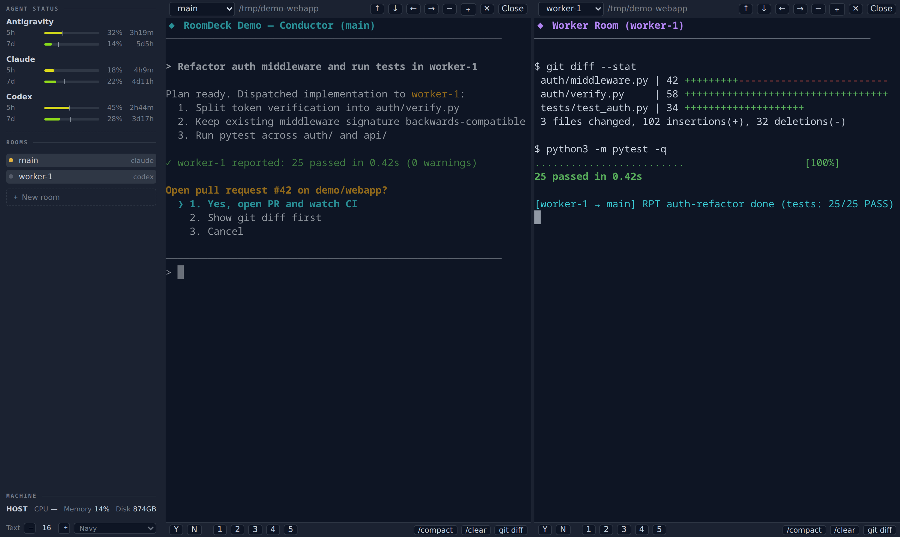

# RoomDeck

A lightweight, zero-dependency browser deck for running multiple AI CLIs (`Claude Code`, `Codex`, `Antigravity`, `Grok`, or any shell) side-by-side over `tmux`.



- **Zero external dependencies**: Python 3 standard library + Vanilla HTML/JS/CSS + `tmux` only. No `npm`, no `pip`, no `ttyd`.
- **Built for AI-assisted workflows**:
  - Multi-pane split layout + single-pane mobile mode (`?mobile=1`) + single-pane embed mode (`?embed=1&room=<name>`).
  - Native browser scrollback & text selection with auto-copy (`✂` toast) and intelligent line-wrap joining.
  - Clickable approval & choice menus (`yes`/`no`/`1–5` toolbar + direct click on terminal choices).
  - Auto-folding of internal agent messages and tool logs, plus user prompt highlighting.
  - Drag-and-drop images/files directly into the active session.
  - 8 built-in themes (`Navy`, `Light`, `Black`, `Tokyo Night`, `Catppuccin Mocha`, `Nord`, `Solarized Dark`, `Warm Paper`).

> **日本語概要**: Python 3 標準ライブラリ＋素の HTML/JS/CSS＋`tmux` だけで動く、複数 AI CLI 並列運用向けの軽量 Web デッキです。まずは下の1行をあなたの AI エージェントに渡してセットアップを任せてください。

## Quick Start (Hand This to Your AI Agent)

### Option A: Using Git / AI Agent directly

Paste this prompt to your AI coding agent (`Claude Code`, `Codex`, `Antigravity`, `Cursor`, etc.):

```text
Read https://github.com/SeBoone-ai/roomdeck (or this local repo) and set up roomdeck for my environment.
```

```text
このリポジトリを読んで、私の環境に合わせて roomdeck をセットアップしてください。
```

### Option B: No Git Required (Download ZIP)

Don't use `git`? Download the ZIP directly, unzip it, and hand the folder to your AI agent:

- **Latest ZIP (1-click)**: https://github.com/SeBoone-ai/roomdeck/archive/refs/heads/main.zip
- **Releases**: https://github.com/SeBoone-ai/roomdeck/releases

> **Git を使わない手順**: 上の ZIP リンクをクリックしてダウンロード → 解凍したフォルダを AI エージェント（Claude Code / Codex / Antigravity / Cursor など）で開き、「このフォルダの `README.md` を読んで、私の環境に合わせて roomdeck をセットアップしてください」と伝えるだけで完了します。

---

## AI Agent Setup & Customization Guide

If you are an AI agent setting up `roomdeck` for the user, follow these steps in order.

### 1. Check OS & Prerequisites

`roomdeck` requires **Python 3.10+** and **`tmux`**.

- **macOS**:
  - Check `python3 --version` and `tmux -V`.
  - Install missing tools via Homebrew: `brew install python tmux`.
- **Linux**:
  - Check `python3 --version` and `tmux -V`.
  - Install missing tools via the distro package manager (e.g. `sudo apt update && sudo apt install -y python3 tmux`).
- **Windows (WSL2 required)**:
  - **Do NOT rewrite `roomdeck` for native Windows.** It relies on `tmux` and POSIX PTYs.
  - Check whether WSL2 is already installed (`wsl --status` in PowerShell, or check if running inside WSL).
  - If WSL2 is not installed, ask the user to run `wsl --install` in an elevated PowerShell, reboot, and enter the distro (`wsl -d Ubuntu`), then run setup inside WSL2 Ubuntu.
  - To use `systemd --user` inside WSL2, ensure `/etc/wsl.conf` has `[boot]\nsystemd=true` (restart with `wsl --shutdown` if newly added).

### 2. Clone, Inspect Installed AI CLIs & Write `~/.config/roomdeck/config.json`

Clone the repository and work from the repository root (`git clone https://github.com/SeBoone-ai/roomdeck.git && cd roomdeck`).
Check which AI CLIs exist on the user's `PATH` (`command -v claude codex agy gemini grok`, where `agy` is Antigravity CLI).
Copy `config.example.json` to `~/.config/roomdeck/config.json` and customize:

- `rooms.clients`: Keep or add the user's preferred CLIs and flags (e.g. `{"claude": ["claude"], "shell": []}`).
- `commands`: Customize the bottom toolbar shortcut buttons (each entry has `id`, `label`, `text`).
- `usage_url` / `usage_file` (optional): Populate the left-sidebar **AGENT STATUS** quota meter from a local loopback JSON endpoint (`http://127.0.0.1:<port>/...`) or a local JSON file (default `~/.local/state/roomdeck/agent-status.json`). Schema:
  ```json
  {
    "agents": [
      {
        "label": "Claude",
        "ok": true,
        "windows": [
          {"win": "5h", "pct": 24, "reset": 1800000000},
          {"win": "7d", "pct": 18, "reset": 1800500000}
        ]
      }
    ]
  }
  ```
- `site`: Keep `hosts` and `origins` restricted to `localhost` / `127.0.0.1` unless configuring a reverse proxy (see Step 4).

Environment variables (all optional):
- `ROOMDECK_PORT` (default `7690`)
- `ROOMDECK_HOST` (default `127.0.0.1` — keep bound to loopback; never bind `0.0.0.0`, which exposes an unauthenticated shell on every interface even when a proxy exists)
- `ROOMDECK_CONFIG` (default `~/.config/roomdeck/config.json`)
- `ROOMDECK_STATE` (default `~/.local/state/roomdeck`)
- `ROOMDECK_TMUX_SOCKET` (optional custom tmux socket path)

### 3. Run & Daemonize

Test manually first from the repository root (so `roomdeck` is on `sys.path`):

```bash
cd /abs/path/to/roomdeck
python3 -m roomdeck.server
```

Then open `http://127.0.0.1:7690/` in the browser.

To run `roomdeck` persistently in the background, resolve absolute paths (`REPO_DIR`, `PYTHON_BIN="$(command -v python3)"`, and the user's full `PATH` including Homebrew / `~/.local/bin` / `~/.npm-global/bin`):

- **Linux / WSL2 (`systemd --user`)**:
  Create `~/.config/systemd/user/roomdeck.service` replacing placeholders with the real absolute paths and `PATH`:
  ```ini
  [Unit]
  Description=RoomDeck Web UI
  After=network.target

  [Service]
  Type=simple
  WorkingDirectory=<REPO_DIR>
  Environment=PATH=<USER_PATH>
  ExecStart=<PYTHON_BIN> -m roomdeck.server
  Restart=on-failure
  RestartSec=3

  [Install]
  WantedBy=default.target
  ```
  Enable and start: `systemctl --user daemon-reload && systemctl --user enable --now roomdeck.service` (on headless Linux, also run `loginctl enable-linger "$USER"`).

- **macOS (`launchd`)**:
  Create `~/Library/LaunchAgents/com.roomdeck.server.plist` with `<key>ProgramArguments</key>` as an array (`[<PYTHON_BIN>, "-m", "roomdeck.server"]`), `<key>WorkingDirectory</key>` set to `<REPO_DIR>`, and `<key>EnvironmentVariables</key>` setting `PATH` so Homebrew `tmux` and user CLIs are found (handles both Apple Silicon `/opt/homebrew/bin` and Intel `/usr/local/bin`). Load with `launchctl bootstrap gui/$(id -u) ~/Library/LaunchAgents/com.roomdeck.server.plist`.

### 4. Safe Remote Access (Phone / Tablet)

Ask the user if they want to access `roomdeck` from a phone or another device.
- **Recommended**: Keep `roomdeck` bound strictly to `127.0.0.1:7690` and expose it only through an authenticated tunnel or HTTPS reverse proxy (e.g. `tailscale serve --bg 7690` — note that Tailscale Serve grants access to peers allowed by your tailnet ACL policy, and on Windows/WSL2 Tailscale must run inside the same WSL2 distro to reach WSL's `127.0.0.1:7690`).
- Add the proxy hostname and origin to `~/.config/roomdeck/config.json`:
  ```json
  "site": {
    "hosts": ["localhost", "127.0.0.1", "my-machine.tailnet.ts.net"],
    "origins": ["http://localhost:7690", "http://127.0.0.1:7690", "https://my-machine.tailnet.ts.net"],
    "devices": []
  }
  ```
- `site.devices`: `[]` allows direct loopback connections only (no `X-Forwarded-For` client allowlist). When behind a reverse proxy that strips/overwrites untrusted incoming `X-Forwarded-For` headers and enforces its own authentication (such as Tailscale Serve), set `"devices": null` to rely on the proxy's auth, or list allowed client IPs in `"devices"`. Never trust `X-Forwarded-For` if direct clients can reach the server.
- **Single-user workstation only (no local auth)**: Even when bound to `127.0.0.1`, any local process running on the same machine can send keystrokes to any `tmux` session on the configured socket without authentication. Do **not** run `roomdeck` on shared or multi-user Linux hosts. To isolate `roomdeck` from your other `tmux` sessions, set `ROOMDECK_TMUX_SOCKET` to a dedicated socket path.
- **Never** bind `roomdeck` to `0.0.0.0` — it has no built-in login screen and grants interactive shell access.

> **セキュリティ注意**: `127.0.0.1` のみに待ち受けていても、同じ PC 上の別プロセスからは認証なしで対象ソケット上の全 `tmux` セッションへ入力できます。個人専用の端末（macOS / 個人用 Linux・WSL2）でお使いいただき、複数人で共有する Linux サーバーでは使用しないでください。通常の `tmux` と分けたい場合は `ROOMDECK_TMUX_SOCKET` で専用ソケットを指定してください。

### 5. URL Modes

- `/?mobile=1` — Single-pane mobile layout with touch-friendly controls.
- `/?embed=1&room=<name>` — Single-pane embed layout (sidebar hidden) focused on a specific tmux session (`<name>` must match `^[A-Za-z0-9_.-]{1,64}$`).
- `/?w=<slot>` — Independent window layout slot in `localStorage`.

---

## Development & Verification (Contributors Only)

Runtime requires only Python 3.10+ and `tmux`. Running the optional test suite additionally requires `pytest` and `node`:

```bash
for f in roomdeck/static/*.js; do node --check "$f"; done
python3 -m pytest tests/ -q
```

## License

[MIT](LICENSE)
